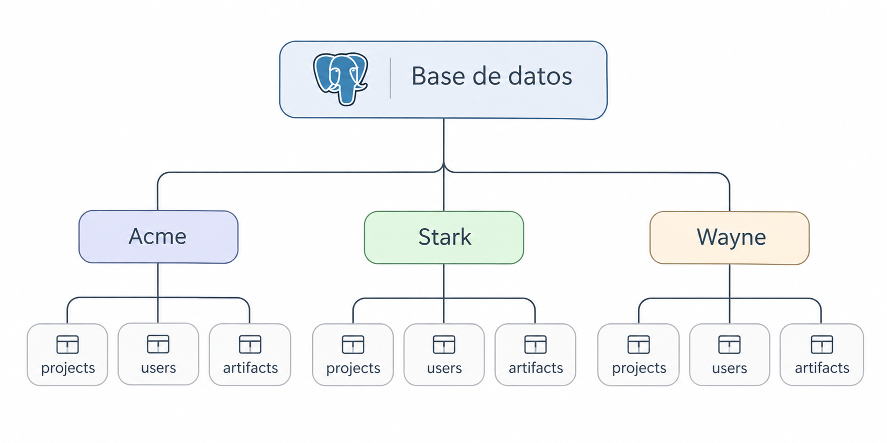

<style>
:root {
  --pg-blue: #336791;
  --ink: #172033;
  --muted: #64748b;
  --soft: #f5f7fb;
  --good: #0f766e;
  --warn: #b45309;
  --bad: #b91c1c;
}

.slidev-layout {
  color: var(--ink);
}

h1 {
  letter-spacing: -0.03em;
}

.pg-card {
  border: 1px solid #dbe3ee;
  border-radius: 18px;
  padding: 1.15rem 1.25rem;
  background: white;
  box-shadow: 0 8px 24px rgba(15, 23, 42, .05);
}

.pg-soft {
  background: var(--soft);
  border-radius: 18px;
  padding: 1.15rem 1.25rem;
}

.pg-kicker {
  text-transform: uppercase;
  letter-spacing: .14em;
  font-size: .7rem;
  font-weight: 800;
  color: var(--pg-blue);
}

.pg-big {
  font-size: 2.1rem;
  line-height: 1.18;
  font-weight: 800;
  letter-spacing: -.03em;
}

.pg-muted {
  color: var(--muted);
}

.pg-arrow {
  font-size: 2rem;
  color: var(--pg-blue);
  font-weight: 700;
}

.pg-good { color: var(--good); }
.pg-warn { color: var(--warn); }
.pg-bad  { color: var(--bad); }

code {
  font-size: .92em;
}
</style>

# Multi-Tenancy en PostgreSQL


<div class="mt-8 text-lg opacity-70">
Más allá del tenant_id
</div>

---
layout: two-cols
---

<div class="pg-kicker">Sobre mí</div>

# Eduardo Ismael

<div class="mt-6 text-3xl font-extrabold tracking-tight">Senior Software developer</div>
<div class="mt-2 text-lg opacity-60">@plusplus</div>
<div class="mt-6 text-xl leading-relaxed">
  Desarrollador Backend con Python y Ruby<br>
  12 años en la industria<br>
</div>

::right::


---
layout: two-cols
---

<div class="pg-kicker">Sobre mí</div>

# Eduardo Ismael

<div class="mt-6 text-3xl font-extrabold tracking-tight">Senior Software developer</div>
<div class="mt-2 text-lg opacity-60">@plusplus</div>
<div class="mt-6 text-xl leading-relaxed">
  Desarrollador Backend con Python y Ruby<br>
  12 años en la industria<br>
  Se hacer Joins 😄
</div>

::right::


---
layout: center
class: text-center
---

# Un Saas 🪴

<div class="mt-6 text-2xl opacity-80">
Cada company necesita manejar su propia data
</div>

---
layout: default
---

# Una misma aplicación para múltiples clientes

<div class="grid grid-cols-3 gap-6 mt-10">
  <div class="pg-card text-center">
    <div class="text-4xl">🏢</div>
    <div class="font-bold text-xl mt-3">Acme</div>
    <div class="pg-muted mt-2">Tenant A</div>
  </div>

  <div class="pg-card text-center">
    <div class="text-4xl">🏭</div>
    <div class="font-bold text-xl mt-3">Stark</div>
    <div class="pg-muted mt-2">Tenant B</div>
  </div>

  <div class="pg-card text-center">
    <div class="text-4xl">🏙️</div>
    <div class="font-bold text-xl mt-3">Wayne</div>
    <div class="pg-muted mt-2">Tenant C</div>
  </div>
</div>

<div class="mt-12 pg-big text-center">
Podemos compartir una misma base de código, infraestructura, observabilidad etc...<br>
<span class="pg-bad">Pero NO podemos compartir datos.</span>
</div>


---

# Es importante distinguir dos conceptos

<div class="grid grid-cols-2 gap-8 mt-10">

<div class="pg-card">
  <div class="font-bold text-2xl">Multi-tenancy</div>
  <div class="mt-4 text-xl">
    Es el requisito de arquitectura.
  </div>
</div>

<div class="pg-card">
  <div class="font-bold text-2xl">Schemas de PostgreSQL</div>
  <div class="mt-4 text-xl">
    Son un mecanismo posible para implementar ese requisito.
  </div>
</div>

</div>

---

# Tres posibles opciones

<div class="grid grid-cols-3 gap-5 mt-8">

<div class="pg-card">
  <div class="text-sm pg-muted">01</div>
  <div class="font-bold text-xl mt-2">Shared tables</div>
  <div class="font-mono mt-5">projects.tenant_id</div>
</div>

<div class="pg-card">
  <div class="text-sm pg-muted">02</div>
  <div class="font-bold text-xl mt-2">Schema per tenant</div>
  <div class="font-mono mt-5">acme.projects</div>
</div>

<div class="pg-card">
  <div class="text-sm pg-muted">03</div>
  <div class="font-bold text-xl mt-2">Database per tenant</div>
  <div class="font-mono mt-5">acme_db</div>
</div>

</div>

---

<div class="pg-kicker">Opción 1</div>

# Shared tables. 

### Una columna para conocer el owner.

<div class="grid grid-cols-2 gap-8 mt-6">

<div>

```sql
CREATE TABLE projects (
  id BIGSERIAL PRIMARY KEY,
  tenant_id BIGINT NOT NULL,
  name TEXT NOT NULL
);
```

</div>

<div class="pg-card font-mono text-sm">

```text
id  tenant_id  name
--  ---------  ----------------
1   1          Acme Website
2   1          Acme API
3   2          Stark Dashboard
```

</div>

</div>

<div class="mt-8">

```sql
SELECT *
FROM projects
WHERE tenant_id = 1 -- Acme;
```

</div>

<div class="mt-7 pg-soft">
Tenant_id responde a la pregunta
<b>“¿A quién pertenecen estos datos?”</b>
</div>


---

<div class="pg-kicker">Desventajas</div>

# Un mal filtro puede convertirse en un data leak

<div class="grid grid-cols-2 gap-8 mt-10">

<div class="pg-card">
  <div class="font-bold pg-good">Esperado</div>

```sql
SELECT *
FROM projects
WHERE tenant_id = 1;
```

</div>

<div class="pg-card">
  <div class="font-bold pg-bad">Bug</div>

```sql
SELECT *
FROM projects;
```

</div>

</div>

<div class="mt-10 text-center text-xl">
Por eso los diseños de shared tables suelen usar
<b>defense in depth</b>.
</div>

<div class="mt-7 text-center">
Application scoping → RLS → constraints → permisos
</div>


---

<div class="pg-kicker">Protección en PostgreSQL</div>

# Row Level Security (RLS)

```sql
ALTER TABLE projects
ENABLE ROW LEVEL SECURITY;

CREATE POLICY tenant_policy
ON projects
USING (
  tenant_id =
  current_setting('app.current_tenant')::BIGINT
);

SET LOCAL app.current_tenant = '1';

SELECT * FROM projects;
 id | tenant_id |     name
----+-----------+--------------
  1 |         1 | Acme Website
```

<div class="grid grid-cols-3 gap-5 mt-8">
  <div class="pg-card text-center">
    <div class="font-bold">App</div>
    <div class="mt-2">Establece el tenant context</div>
  </div>
  <div class="pg-arrow text-center self-center">→</div>
  <div class="pg-card text-center">
    <div class="font-bold">PostgreSQL</div>
    <div class="mt-2">Filtra las rows permitidas</div>
  </div>
</div>

<div class="mt-8 text-center text-lg">
La database puede hacer cumplir el boundary aunque el query esté incompleto.
</div>

---

<div class="pg-kicker">Opción 2</div>

# Schema per tenant

<div class="mt-8 flex items-stretch justify-center gap-5">

<div class="pg-card text-center w-48 flex flex-col justify-center">
  <div class="text-sm pg-muted">Instancia compartida</div>
  <div class="font-bold text-2xl mt-2">PostgreSQL</div>
</div>

<div class="pg-arrow self-center">→</div>

<div class="pg-card flex-1">
  <div class="text-sm pg-muted">Una misma Database con N número de schemas</div>

  <div class="grid grid-cols-5 gap-4 mt-5">
    <div class="pg-soft">
      <div class="font-bold text-lg">Public</div>
      <div class="font-mono text-sm mt-3">tenants<br>domains</div>
      <div class="pg-muted text-sm mt-3">metadata compartida</div>
    </div>
    <div class="pg-soft">
      <div class="font-bold text-lg">Acme</div>
      <div class="font-mono text-sm mt-3">projects<br>users<br>artifacts</div>
    </div>
    <div class="pg-soft">
      <div class="font-bold text-lg">Stark</div>
      <div class="font-mono text-sm mt-3">projects<br>users<br>artifacts</div>
    </div>
    <div class="pg-soft">
      <div class="font-bold text-lg">Wayne</div>
      <div class="font-mono text-sm mt-3">projects<br>users<br>artifacts</div>
    </div>
    <div class="pg-soft">
      <div class="font-bold text-lg">...</div>
    </div>
  </div>
</div>

</div>

<div class="mt-8 text-center text-xl">
La database sigue compartida. Cada tenant tiene su propio schema
y  su propia información.
</div>


---

# ¿Qué son los schema?

<div class="grid grid-cols-2 gap-8 mt-6">

<div class="pg-card">

```sql
CREATE SCHEMA acme;
CREATE SCHEMA stark;
CREATE SCHEMA wayne;

CREATE TABLE acme.projects (
  id BIGSERIAL PRIMARY KEY,
  name TEXT NOT NULL
);

CREATE TABLE stark.projects (
  id BIGSERIAL PRIMARY KEY,
  name TEXT NOT NULL
);

CREATE TABLE wayne.projects (
  id BIGSERIAL PRIMARY KEY,
  name TEXT NOT NULL
);
```

</div>

<div class="pg-card">

Un <b>schema</b> es un namespace dentro de una misma base de datos.
Agrupa tablas, vistas, funciones y otros objetos bajo un nombre.

<div class="mt-5">
<code>acme.projects</code> , <code>stark.projects</code>  y <code>wayne.projects</code>
pueden existir juntas en la misma base de datos sin compartir filas ni datos.
</div>

<div class="mt-5">
En este modelo, <code>tenant_id</code> suele ser innecesario
dentro de las tablas del tenant.
</div>

</div>

</div>

---

# El mismo nombre, otra relation

<div class="mt-4 text-lg">
Aunque ambas se llamen <code>users</code>, <code>acme.users</code> y <code>stark.users</code>
son relations distintas.
</div>

<div class="grid grid-cols-2 gap-8 mt-6">

<div class="pg-card">
  <div class="font-bold text-lg">Cada una tiene lo suyo</div>
  <div class="mt-4 leading-relaxed">
    Storage físico y rows<br>
    Indexes y statistics<br>
    Primary keys y unique constraints<br>
    Foreign keys<br>
    Locks a nivel de tabla<br>
    Autovacuum y estado de mantenimiento
  </div>
</div>

<div class="pg-card">
  <div class="font-bold text-lg">Qué es un schema</div>
  <div class="mt-4 text-lg leading-relaxed">
    No es otra database ni un storage engine.
    Es, ante todo, un <b>namespace</b> y un <b>permission boundary</b>.
  </div>
  <div class="mt-5 text-sm pg-muted">
    PostgreSQL documenta esta distinción.
  </div>
</div>

</div>

---

# Qué tenemos

<div class="mt-4 flex items-center justify-center">
  
</div>

---


# Comandos y Queries

<div class="grid grid-cols-2 gap-8 mt-7">

<div class="pg-card">

```sql

live=# \dn
 List of schemas
  Name  |  Owner  
--------+---------
 acme   | eduardo
 public | eduardo <--- Default
 stark  | eduardo
 wayne  | eduardo

\dt acme.*
          List of relations
 Schema |   Name   | Type  |  Owner  
--------+----------+-------+---------
 acme   | projects | table | eduardo
(1 row)
 
```

<div class="mt-5">
PostgreSQL ya utiliza schemas.
Si no se define uno, se utiliza <code>public</code> por defecto.
</div>


</div>

<div class="pg-card">


```sql
INSERT INTO stark.projects (name)
VALUES
  ('Stark Dashboard'),
  ('Arc Reactor Monitoring'),
  ('Stark Inventory');
```

<div class="mt-8">

```sql
live=# SELECT * FROM stark.projects;
 id |          name          
----+------------------------
  1 | Stark Dashboard
  2 | Arc Reactor Monitoring
  3 | Stark Inventory
(3 rows)

live=# 
```

</div>

</div>

</div>

---

<div class="pg-kicker">Routing</div>

# `search_path` le dice a PostgreSQL dónde buscar

<div class="grid grid-cols-2 gap-8 mt-7">

<div class="pg-card">

```sql
SET search_path
TO stark, public;

INSERT INTO projects (name)
VALUES ('Stark Satellite Uplink');

SELECT * FROM projects;

 id |          name          
----+------------------------
  1 | Stark Dashboard
  2 | Arc Reactor Monitoring
  3 | Stark Inventory
  4 | Stark Satellite Uplink

```

</div>

<div class="pg-card">

PostgreSQL resuelve:

```text
projects
   ↓
stark.projects
```

Si no lo encuentra:

```text
public.projects
```

</div>

</div>


---

<div class="pg-kicker">django-tenants</div>

# Un request, un schema

<div class="mt-6 text-center font-mono text-base leading-relaxed">
stark.example.com<br>
↓<br>
Tenant middleware<br>
↓<br>
resolve tenant = stark<br>
↓<br>
search_path → stark, -public-<br>
↓<br>
Project.objects.all()<br>
↓<br>
stark.projects
</div>

<div class="mt-6 text-center text-base">
La librería elige el schema. El query del ORM no cambia.
</div>

---

<div class="pg-kicker">Enforcement</div>

# Los schemas pueden tener permisos

<div class="grid grid-cols-2 gap-8 mt-6">

<div>

```sql
GRANT USAGE
ON SCHEMA acme
TO acme_role;

GRANT SELECT, INSERT,
UPDATE, DELETE
ON ALL TABLES
IN SCHEMA acme
TO acme_role;
```

</div>

<div class="pg-card">
  <div class="font-bold text-lg">Dos ideas distintas</div>

  <div class="mt-6">
    <b>search_path</b><br>
    <span class="pg-muted">¿Dónde debe buscar PostgreSQL?</span>
  </div>

  <div class="mt-6">
    <b>GRANT / REVOKE</b><br>
    <span class="pg-muted">¿A qué puede acceder realmente este role?</span>
  </div>
</div>

</div>


---

<div class="pg-kicker">Application roles</div>

# Least privilege Principel

<div class="mt-8 flex items-center justify-center gap-6">

<div class="pg-card text-center">
  <div class="font-bold">app_login 🔑</div>
  <div class="mt-3 text-sm">
    PostgreSQL User
  </div>
</div>

<div class="pg-arrow">→</div>

<div class="grid grid-cols-3 gap-4">

  <div class="pg-card text-center">
    <div class="font-bold pg-good">acme_role</div>
    <div class="mt-3 text-sm">
      acme.*
    </div>
  </div>

  <div class="pg-card text-center">
    <div class="font-bold">stark_role</div>
    <div class="mt-3 text-sm">
      stark.*
    </div>
  </div>

  <div class="pg-card text-center">
    <div class="font-bold">wayne_role</div>
    <div class="mt-3 text-sm">
      wayne.*
    </div>
  </div>

</div>

</div>

<div class="mt-10 pg-soft text-center text-xl">

La connection puede servir a muchos tenants,<br>
pero cada request opera con los permisos de <b>un solo tenant</b>.

</div>

<div class="mt-8 text-center text-lg">

El login tiene la capacidad de asumir varios roles.<br>
El <b>current role</b> limita los privilegios activos durante el request.

</div>

---

<div class="pg-kicker">django-tenants</div>

# Un request, un role

<div class="mt-6 text-center font-mono text-base leading-relaxed">
stark.example.com<br>
↓<br>
Tenant middleware<br>
↓<br>
resolve tenant = stark<br>
↓<br>
SET LOCAL ROLE stark_role<br>
↓<br>
search_path → stark, public<br>
↓<br>
Project.objects.all()<br>
↓<br>
stark.projects
</div>

<div class="mt-6 text-center text-base">
El schema rutea. El role limita qué puede tocar este request.
</div>

---
layout: two-cols-header
layoutClass: gap-x-12
---

<div class="pg-kicker">Least privilege por request</div>

# Reduciendo el scope

::left::

### Request de Acme ✅

```sql
BEGIN;

SET LOCAL ROLE acme_role;

SET LOCAL search_path
TO acme, public;

SELECT *
FROM projects;

COMMIT;
```

Durante esta transacción:

```text
acme.projects   ✅
stark.projects  ❌
wayne.projects  ❌
```

::right::

### Bug accidental ❌

```sql
SELECT *
FROM stark.projects;
```

PostgreSQL responde:

```text
ERROR: permission denied
for table projects
```

Porque el role activo es:

```text
current_user = acme_role
```

<div class="mt-4 pg-soft text-sm">

Aunque `app_login` pueda asumir `stark_role` en otro request, **este request** está limitado a los permisos de `acme_role`.

</div>

---

<div class="pg-kicker">Idea clave</div>

# No es aislamiento absoluto

<div class="grid grid-cols-2 gap-8 mt-8">

<div class="pg-card">

### Sí protege contra ✅

- Queries al schema equivocado
- Accesos accidentales
- Bugs en queries
- Un `search_path` incorrecto
- Mayor blast radius por request

</div>

<div class="pg-card">

### No protege contra ❌

- La app seleccionando el role incorrecto
- Una app completamente comprometida
- `app_login` usando otro tenant role intencionalmente

</div>

</div>

<div class="mt-10 text-center text-xl">

**El login tiene capacidad global.  
El request trabaja con privilegios locales.**

</div>

---
layout: center
class: text-center
---

# Desventajas ❗

---

# Connection pooling

<div class="mt-8 flex items-center justify-center gap-6">

<div class="pg-card text-center">
  <div class="font-bold">Tenants</div>
  <div class="mt-3">A · B · C </div>
</div>

<div class="pg-arrow">→</div>

<div class="pg-card text-center">
  <div class="font-bold">Web app</div>
  <div class="mt-3">tenant resolver</div>
</div>

<div class="pg-arrow">→</div>

<div class="pg-card text-center">
  <div class="font-bold">Pool</div>
  <div class="mt-3 font-mono">C1 C2 C3</div>
</div>

<div class="pg-arrow">→</div>

<div class="pg-card text-center">
  <div class="font-bold">PostgreSQL</div>
  <div class="mt-3">Una database</div>
</div>

</div>

<div class="mt-12 pg-big text-center">
Una connection no debería pertenecer de forma permanente a un tenant.
</div>

<div class="mt-3 pg-big text-center">
<code>search_path</code> puede ser peligroso con connections reutilizadas.
</div>


---

<div class="pg-kicker">Riesgo del pooling</div>

# El estado del tenant puede filtrarse por una connection reutilizada

<div class="grid grid-cols-2 gap-8 mt-7">

<div class="pg-card">

<div class="font-bold pg-bad">Riesgoso</div>

```sql
SET search_path TO acme;

-- el request termina
-- la connection vuelve al pool
```

<div class="mt-3">
¿Qué estado hereda el siguiente request?
</div>

</div>

<div class="pg-card">

<div class="font-bold pg-good">Idea genérica con scope de transacción</div>

```sql
BEGIN;

SET LOCAL search_path
TO acme, public;

-- queries

COMMIT;
```

</div>

</div>

<div class="mt-9 text-center text-xl">
<b>Las connections pertenecen al pool.<br>
El tenant context pertenece al request o a la transacción.</b>
</div>


---

<div class="pg-kicker">Noisy neighbor</div>

# Un tenant ruidoso vuelve lenta a toda la database

<div class="grid grid-cols-2 gap-8 mt-6">

<div class="pg-card">
  <div class="font-bold">Qué se comparte</div>
  <div class="mt-4 leading-relaxed">
    CPU y I/O<br>
    Locks<br>
    Connections<br>
    <code>shared_buffers</code>
  </div>
  <div class="mt-5">
    Un reporte o un import de Acme hace esperar al resto de tenants.
  </div>
</div>

<div class="pg-card">
  <div class="font-bold">Qué ayuda</div>
  <div class="mt-4 leading-relaxed">
    Índices y queries acotados<br>
    <code>statement_timeout</code><br>
    Mover al tenant ruidoso a otra database<br>
    Si el CPU o el disco no alcanzan, a otra instancia
  </div>
</div>

</div>

<div class="mt-8 text-center text-xl">
Schema-per-tenant aísla los datos, no los recursos.
</div>

---

<div class="pg-kicker">Noisy neighbor</div>

# Primero identifica al tenant

<div class="grid grid-cols-3 gap-5 mt-6">

<div class="pg-card">
  <div class="font-bold">pg_stat_statements</div>
  <div class="mt-4 text-sm leading-relaxed">
    Etiqueta el query con
    <code>application_name</code>
    o un comentario
    <code>/* tenant=acme */</code>.
    El texto agrupado dice qué tenant lo corrió.
  </div>
</div>

<div class="pg-card">
  <div class="font-bold">pg_stat_activity</div>
  <div class="mt-4 text-sm leading-relaxed">
    Qué sesión lleva mucho tiempo.<br>
    Quién sostiene un lock.<br>
    Quién espera I/O.
  </div>
</div>

<div class="pg-card">
  <div class="font-bold">Vistas del sistema</div>
  <div class="mt-4 text-sm leading-relaxed">
    Scans, bloques leídos y tuplas devueltas.
    En schema-per-tenant, el schema de la vista ya es el tenant.
  </div>
</div>

</div>

<div class="mt-8 text-center text-xl">
Sin una etiqueta, el query ruidoso no tiene tenant.
</div>

---

<div class="pg-kicker">Noisy neighbor</div>

# Qué puedes hacer

<div class="grid grid-cols-2 gap-8 mt-5">

<div class="pg-card">
  <div class="font-bold">Timeouts</div>
  <div class="mt-1 text-sm pg-muted">El circuit breaker más barato</div>

```sql
ALTER ROLE acme_role SET
  statement_timeout = '30s';

ALTER ROLE acme_role SET
  lock_timeout = '5s';

ALTER ROLE acme_role SET
  idle_in_transaction_session_timeout
    = '60s';
```

  <div class="mt-3 text-sm">
    El default entra al hacer login.
    Quien pueda ejecutar <code>SET</code> todavía puede alargarlo.
  </div>
</div>

<div>

<div class="pg-card">
  <div class="font-bold">Límite de connections</div>

```sql
ALTER ROLE acme_role
  CONNECTION LIMIT 20;
```

  <div class="mt-3 text-sm">
    Ese login no puede agotar <code>max_connections</code>.
    En database-per-tenant, el límite va en la database.
  </div>
</div>

<div class="pg-card mt-4">
  <div class="font-bold">Índices y queries</div>
  <div class="mt-3 text-sm leading-relaxed">
    En shared tables, <code>tenant_id</code> va primero en el índice.<br>
    Un whale puede usar un índice parcial.<br>
    Evita <code>SELECT *</code> y joins cartesianos.
  </div>
</div>

</div>

</div>

---


# Las migrations pueden volverse un problema

<div class="grid grid-cols-2 gap-10 mt-8">

<div>
<div class="font-bold text-xl mb-5">Shared table</div>

```text
public.projects
      │
      ▼
  migration
      │
      ▼
     listo
```
</div>

<div>
<div class="font-bold text-xl mb-5">Schema per tenant</div>

```text
acme.projects   → migrate
stark.projects  → migrate
wayne.projects  → migrate
tenant_004      → migrate
tenant_005      → migrate
...
```
</div>

</div>

<div class="mt-10 text-center text-xl">
Una migration lógica se convierte en <b>N migrations físicas</b>.
</div>

---


# ¿Qué pasa si el Tenant C falla?

<div class="mt-8 font-mono text-xl leading-10">

```text
Tenant A  → v15  ✅ committed
Tenant B  → v15  ✅ committed
Tenant C  → v14  ❌ migration fallida
Tenant D  → v14  ⏳ pending
Tenant E  → v14  ⏳ pending
```

</div>

<div class="mt-10 pg-soft">
Si A y B ya hicieron commit, normalmente <b>siguen migrados</b>.

El Tenant C puede hacer rollback de <b>su propia</b> migration.

Ahora producción contiene temporalmente <b>varias versiones de schema</b>.
</div>


---

# Más observabilidad

<div class="grid grid-cols-3 gap-5 mt-8">

<div class="pg-card">
  <div class="font-bold">1. Track</div>
  <div class="mt-4 font-mono text-sm">
    acme → v15<br>
    stark → v15<br>
    wayne → v14
  </div>
</div>

<div class="pg-card">
  <div class="font-bold">2. Retry</div>
  <div class="mt-4 text-sm">
    Omite los tenants completados.<br>
    Reintenta solo los tenants fallidos o pending.
  </div>
</div>

<div class="pg-card">
  <div class="font-bold">3. Report</div>
  <div class="mt-4 text-sm">
    Saber exactamente qué tenant falló y por qué.
  </div>
</div>

</div>

<div class="mt-10 text-center text-xl">
Un migration runner debe ser <b>restartable</b>, no “todo o nada para siempre”.
</div>


---

# ¿Qué pasa si Acme necesita una columna custom?

<div class="grid grid-cols-2 gap-8 mt-6">

<div>

```sql
ALTER TABLE acme.projects
ADD COLUMN cost_center TEXT;
```

<div class="mt-5 font-mono text-sm">
Acme  → projects + cost_center<br>
Stark → projects estándar<br>
Wayne → projects estándar
</div>

</div>

<div class="pg-card">
  <div class="font-bold pg-warn text-xl">Técnicamente fácil.</div>
  <div class="mt-4 text-lg">Operativamente caro.</div>

  <div class="mt-5 text-sm">
    Las migrations divergen<br>
    Las suposiciones del ORM divergen<br>
    El testing crece<br>
    Las versiones de los tenants se vuelven más difíciles de razonar
  </div>
</div>

</div>

<div class="mt-8 text-center">
Prefiere <b>JSONB</b> o <b>JSON</b> 
cuando la personalización es data, no un producto realmente distinto.
</div>


---

<div class="pg-kicker">Cuándo consideraría schema-per-tenant</div>

# Schema-per-tenant es atractivo cuando…

<div class="grid grid-cols-2 gap-7 mt-8">

<div class="pg-card">
  <div class="font-bold pg-good">Buen fit</div>
  <div class="mt-5">
    Un namespace claro por tenant importa<br><br>
    Los permisos por schema son útiles<br><br>
    El número de tenants es manejable operativamente<br><br>
    Puedes invertir en orquestación de migrations
  </div>
</div>

<div class="pg-card">
  <div class="font-bold pg-warn">Cuidado cuando</div>
  <div class="mt-5">
    El número de tenants puede volverse masivo<br><br>
    El schema cambia mucho por cada tenant<br><br>
    Las migrations son frecuentes o pesadas<br><br>
  </div>
</div>

</div>

---

<div class="pg-kicker">Opción 3</div>

# Database per tenant

<div class="mt-8 flex items-stretch justify-center gap-5">

<div class="pg-card text-center w-48 flex flex-col justify-center">
  <div class="text-sm pg-muted">Instancia compartida</div>
  <div class="font-bold text-2xl mt-2">PostgreSQL</div>
</div>

<div class="pg-arrow self-center">→</div>

<div class="pg-card flex-1">
  <div class="text-sm pg-muted">Una database por tenant</div>

  <div class="grid grid-cols-3 gap-4 mt-5">
    <div class="pg-soft">
      <div class="font-bold text-lg">acme_db</div>
      <div class="font-mono text-sm mt-3">projects<br>tasks</div>
    </div>
    <div class="pg-soft">
      <div class="font-bold text-lg">stark_db</div>
      <div class="font-mono text-sm mt-3">projects<br>tasks</div>
    </div>
    <div class="pg-soft">
      <div class="font-bold text-lg">wayne_db</div>
      <div class="font-mono text-sm mt-3">projects<br>tasks</div>
    </div>
  </div>
</div>

</div>

<div class="mt-8 text-center text-xl">
El boundary es la database. Un query en <code>acme_db</code>
no ve las tablas de <code>stark_db</code>.
</div>

---

<div class="pg-kicker">Opción 3</div>

# Database per tenant es atractivo cuando…

<div class="grid grid-cols-2 gap-7 mt-8">

<div class="pg-card">
  <div class="font-bold pg-good">Buen fit</div>
  <div class="mt-5">
    Hay que hacer backup, restore o drop de un tenant sin tocar a los demás<br><br>
    Un tenant es muy grande, o tiene compliance propio<br><br>
    Quieres límites de recursos distintos por tenant<br><br>
    El número de tenants se mantiene bajo
  </div>
</div>

<div class="pg-card">
  <div class="font-bold pg-warn">Cuidado cuando</div>
  <div class="mt-5">
    Cada request tiene que rutear a otra connection string<br><br>
    El pool se fragmenta: más connections hacia PostgreSQL<br><br>
    Provisioning, backups y migrations se multiplican por database<br><br>
    Un reporte cross-tenant ya no es un SELECT
  </div>
</div>

</div>

---

<div class="pg-kicker">Conclusión</div>

# El boundary que eliges es el costo que operas

<div class="grid grid-cols-3 gap-5 mt-6">

<div class="pg-card">
  <div class="text-sm pg-muted">01</div>
  <div class="font-bold text-xl mt-2">Shared tables</div>
  <div class="mt-4 text-sm leading-snug">
    El boundary vive en el <b>row</b>.<br><br>
    Un filtro olvidado es un data leak.<br>
    RLS es la red de seguridad.
  </div>
</div>

<div class="pg-card">
  <div class="text-sm pg-muted">02</div>
  <div class="font-bold text-xl mt-2">Schema per tenant</div>
  <div class="mt-4 text-sm leading-snug">
    El boundary vive en el <b>schema</b>.<br><br>
    <code>search_path</code> rutea. GRANT aísla.<br>
    Cuida el connection state y las migrations.
  </div>
</div>

<div class="pg-card">
  <div class="text-sm pg-muted">03</div>
  <div class="font-bold text-xl mt-2">Database per tenant</div>
  <div class="mt-4 text-sm leading-snug">
    El boundary vive en la <b>database</b>.<br><br>
    El aislamiento es el más claro.<br>
    Pagas routing, pools y operaciones por tenant.
  </div>
</div>

</div>

<div class="mt-8 text-center text-xl">
No hay un ganador universal. Elige el boundary que tu equipo puede operar.
</div>


---
layout: center
class: text-center
---

# Muchas gracias. ⛰️

---